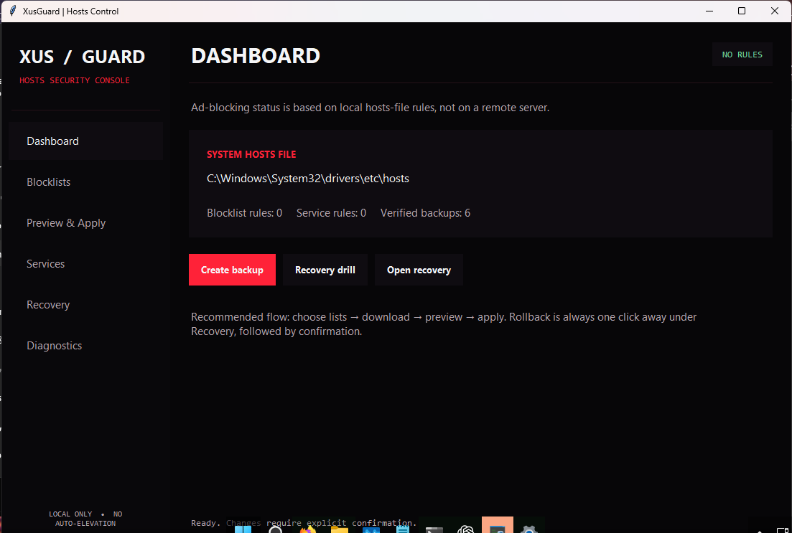
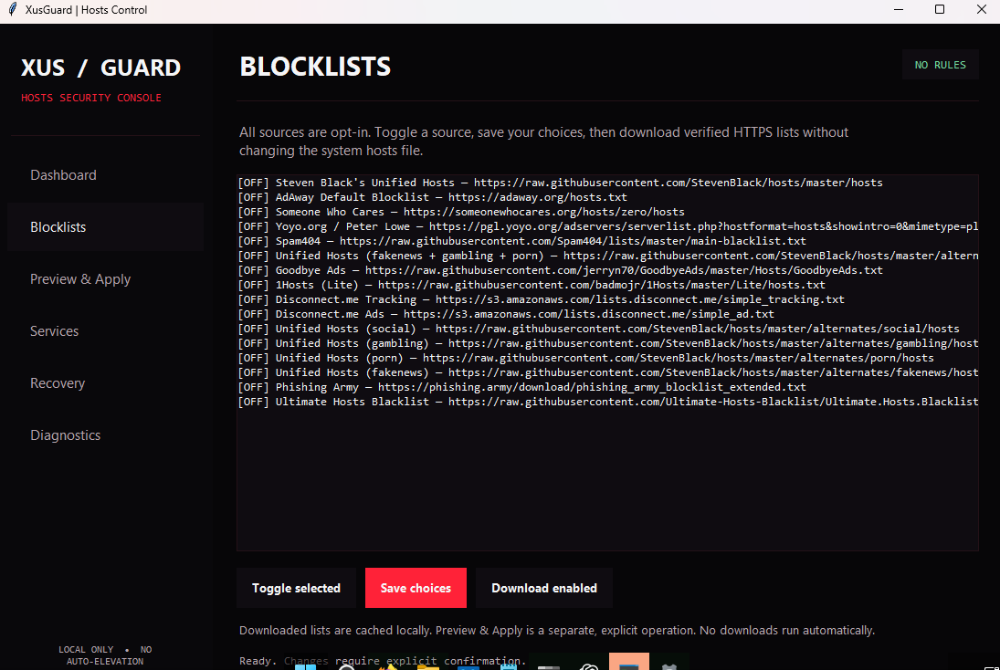
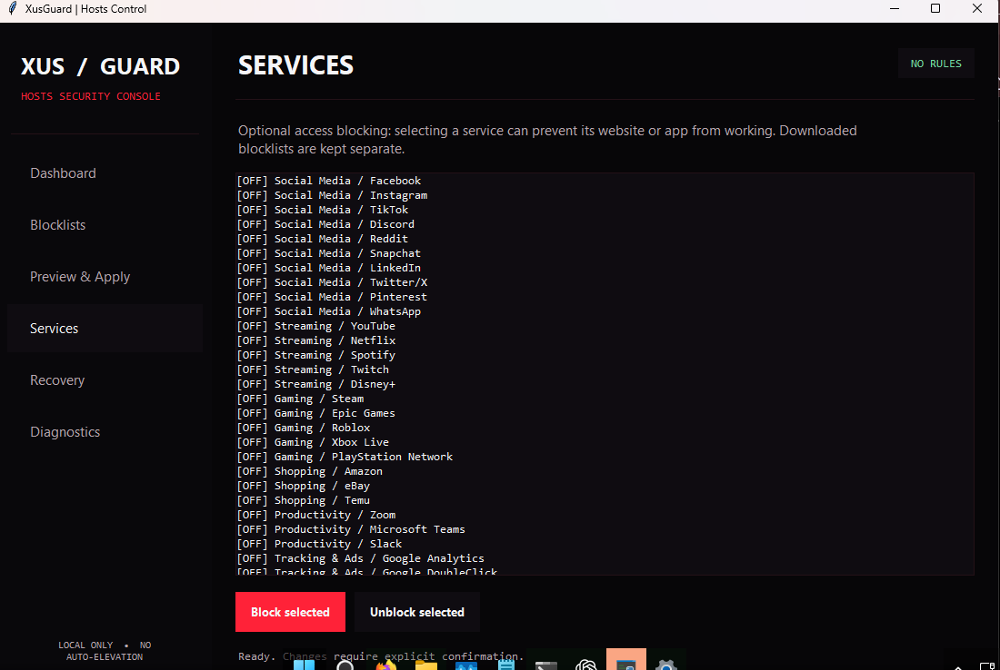
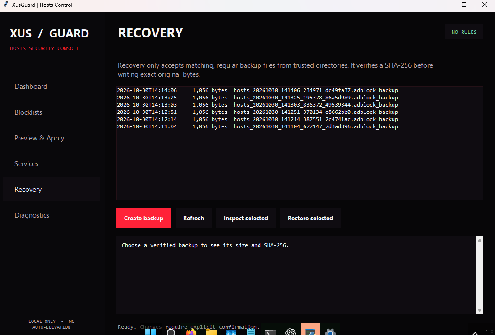

# 🛡️ XusGuard

**XusGuard v2.1.0**

A personal, cross-platform hosts-file blocker for **Windows, macOS, and Linux**. XusGuard helps block selected advertising and tracking domains using your computer's hosts file. No upstream project download, release lookup, or execution is required.

> **Security first:** XusGuard changes system-wide DNS behavior. Review the code and enabled blocklists before using administrator/root privileges. Blocklists are third-party data, not inherently trustworthy.

## Desktop GUI screenshots

Explore the native XusGuard interface. Select an image to view it at full resolution.

<table>
  <tr>
    <td width="50%" align="center">
      <a href="docs/screenshots/dashboard.png"></a>
      <br><strong>Dashboard</strong><br>Hosts-file status and backup overview
    </td>
    <td width="50%" align="center">
      <a href="docs/screenshots/blocklists.png"></a>
      <br><strong>Blocklists</strong><br>Select and download trusted sources
    </td>
  </tr>
  <tr>
    <td width="50%" align="center">
      <a href="docs/screenshots/services.png"></a>
      <br><strong>Services</strong><br>Optional app and website blocking
    </td>
    <td width="50%" align="center">
      <a href="docs/screenshots/recovery.png"></a>
      <br><strong>Recovery</strong><br>Verified backups and safe rollback
    </td>
  </tr>
</table>

<sub>All four PNG screenshots were rebuilt with identical pixels and no embedded metadata. Screenshots may differ slightly from newer builds.</sub>

## What makes this edition different?

- **Local-only launchers:** `install.bat` and `install.sh` run the checked-out Python file. They never download and execute remote Python code or silently install packages.
- **Verified HTTPS:** external blocklists require valid TLS certificates, HTTPS redirects, and a 32 MiB per-download limit.
- **Strict hostnames:** invalid domains, IP redirections and malformed blocklist lines are discarded.
- **Fail-closed writes:** every hosts-file replacement requires a backup; writes are staged to a temporary file in the destination directory before replacement. If replacement is blocked, XusGuard reports an error instead of truncating the original.
- **Explicit ownership:** new managed records sit between `# BEGIN XUSGUARD MANAGED` and `# END XUSGUARD MANAGED`. Other entries are preserved.
- **Opt-in lists:** all sources are disabled until you choose one. Cached lists and backups are kept outside the repository.
- **Safe source management:** Corrupted configuration is preserved rather than overwritten; caches are saved atomically and cache names avoid collisions.
- **Owned redirects only:** Redirect controls only remove mappings explicitly marked as XusGuard-owned.
- **Independent service rules:** Explicit service blocking lives in its own managed hosts section, so toggling a service cannot silently delete entries supplied by a downloaded blocklist.
- **Safe cleanup:** non-interactive cleanup cannot delete backups or preferences.

## Installation

Requires **Python 3.10+** and an internet connection **only if you download a blocklist**. XusGuard does not auto-install Python, `pip`, or dependencies.

1. [Download this repository as a ZIP](https://github.com/EngineXus-dev/XusGuard/archive/refs/heads/main.zip), or clone it from your own repository. Extract the entire folder.
2. Read `sources.json`, `xusguard.py`, and the launcher for your OS.
3. Run **`install.bat`** in Windows or **`bash install.sh`** in Linux/macOS. To run directly: `py -3 xusguard.py` (Windows) or `python3 xusguard.py` (Linux/macOS).
4. First use **Backup current hosts file**. Then enable **one reputable HTTPS blocklist**, download/update, inspect the result, and confirm installation.
5. Elevate **only when changing the system hosts file**. If replacement is blocked by your OS security settings, XusGuard fails rather than weakening protections.

Do **not** paste a `curl | bash` or downloaded-code PowerShell one-liner into an elevated shell.

## What it does

The text menu lets you select/download third-party lists, merge and deduplicate domains, see statistics, inspect the hosts file, back it up, restore it, flush the DNS cache, choose service categories, and add or remove marked domain redirects.

### Supported blocklists

XusGuard accepts **hosts files** (for example, `0.0.0.0 ads.example` or `127.0.0.1 ads.example`) and **one-domain-per-line** lists. It does **not** parse Adblock Plus, uBlock Origin, or IP-only feeds. Ten incompatible preset feeds were previously removed; four more obsolete, duplicate or broken presets were subsequently retired. **All 16 remaining opt-in feeds passed the October 30, 2026 live HTTPS and hosts-format check.** This is not an integrity, age or false-positive guarantee. See [feed verification report](docs/FEED_STATUS.md) and the read-only [auditor](scripts/verify_feeds.py). A third-party source may change its format or availability at any time.

If a verified download fails, XusGuard does not silently install an expired cached list. Cache filenames changed in v2.0.1 to avoid collisions, so existing cached lists may be fetched again when first enabled. To avoid security surprises, the tool also refuses to overwrite a malformed `sources.json`; repair that file manually if it becomes damaged.

### Service blocking (optional)

The old service catalog contained **554 hard-coded entries**, including broad, high-risk categories such as government domains and fake-news classifications. It has been reduced to **31 explicitly selectable services across six categories** in [services.json](services.json): Social Media, Streaming, Gaming, Shopping, Productivity, and Tracking & Ads.

Service blocking is **not** the same as filtering advertising or tracking. Enabling YouTube, Steam or another named service can deliberately prevent the service from loading. Nothing in the catalog is enabled by default.

XusGuard manages service toggles in a separate `# BEGIN XUSGUARD SERVICES` / `# END XUSGUARD SERVICES` section, distinct from the downloaded blocklist section. Turning a service off only removes XusGuard's explicit service rules; a domain may remain blocked by a third-party list.

**Migration:** Old, unmanaged service entries from pre-2.1 installations cannot be removed automatically without risking unrelated hosts mappings. Review those entries or restore a known-good pre-install backup. Custom service lists must now be maintained in `services.json`; its schema is validated before use.

### Backups and recovery

Every safe write saves a private timestamped backup:

- Windows: `%LOCALAPPDATA%\XusGuard\hosts_backups` (or the current user's home folder if LOCALAPPDATA is absent)
- Linux/macOS: `~/.local/share/xusguard/hosts_backups`

Downloaded lists are cached next to the backups under `hosts_sources`. **If launched as Administrator/root, the effective account may have a different backup directory.** Keep a separate backup outside this tool as well.

The restore menu also looks for older backups in the repository's former `hosts_backups` folder. Restoring a default hosts template removes custom mappings; prefer restoring your own verified backup.

**Migration warning:** Entries previously added by older, unmarked releases are not automatically identified or deleted. XusGuard deliberately avoids guessing which entries it owns. Restore a known-good pre-installation hosts backup or manually review older entries before your first v2 installation.

### Important limitations

- Hosts-file blocking cannot reliably filter page elements, first-party advertising, or DNS traffic that bypasses the OS resolver.
- Blocking selected services can disrupt logins, software updates, and websites.
- HTTPS validates the transport, **not** that a third-party list is benign.
- Atomic replacements can be denied by Windows file protection, antivirus, or system ACLs. A failed replacement is **not** a successful install.
- The Python source is still a large legacy application; automated tests do not replace a full multi-platform security audit.
- XusGuard is not antivirus, a malware guarantee, or an enterprise DNS firewall.

## Desktop GUI — XusGuard Control Center

XusGuard now includes an **optional native Tkinter desktop interface** with dark charcoal, crimson accents and a sidebar adapted from the owner's AnonEngine UI design. No AnonEngine backend, JavaScript, browser APIs, services, or remote content are needed. It shares the same XusGuard Python backend and standard-library dependencies.

- **Windows:** Double-click `start_gui.bat` (or run `py -3 xusguard_gui.py`).
- **Linux/macOS:** Run `bash start_gui.sh` (or `python3 xusguard_gui.py`). Tkinter is required; some Linux distributions package it as `python3-tk`.

The dashboard displays local hosts-file state; **Blocklists** manages opt-in sources and explicit downloads; **Preview & Apply** previews *locally cached, fresh* lists and verifies the hosts file and sources again before any write; **Services** manages the separate, opt-in access-blocking rules; **Recovery** lists verified backups with SHA-256 digests and requires `RESTORE` confirmation; **Diagnostics** runs the entire disposable-file recovery drill with one button.

**Click-to-toggle multi-selection:** On the Blocklists and Services pages, click any row to select it; click it again to deselect. Several selections stay highlighted without Ctrl or Shift, including after taking an action or navigating away. Use **Toggle selected sources** for several blocklist sources at once, or **Block/Unblock selected** for selected services. The **Recovery** page intentionally remains single-select to prevent accidental multi-backup restores.

**Readable Diagnostics:** Recovery drills show a short pass/fail summary by default, including tests passed and skipped. Expected negative-test errors are hidden from the summary; choose **Show / hide detailed output** for a sanitized, ANSI-free technical log. A deliberately blocked write, damaged backup, or invalid test encoding is expected when its test reports `ok`.


**Privilege model:** Browsing and downloads do not require administrator/root permissions. Applying, restoring, or blocking a service uses the normal OS file permissions; the GUI does **not** auto-elevate or weaken protections. Never treat a green status label as proof that advertisements or trackers are fully blocked.

### Recovery testing and safeguards

`python -m unittest discover -s tests -p "test_recovery.py" -v` executes end-to-end recovery drills on temporary hosts files. It tests a real install-to-backup-to-restore roundtrip, exact-byte recovery of non-UTF-8 historical data, new safety backups before rollback, hash mismatch and tampering rejection, wrong-file and symlink refusals, backup failures, and locked-file/atomic-replacement failures. The GUI offers the same tests under **Diagnostics → Run recovery drill**, with no separate scripts to manage.

**These are disposable-file tests, not a real-system Windows/macOS/Linux installation certification.** Real hosts-file writes have OS permissions, antivirus interactions, ownership, and ACL considerations that must be tested on the target computer. A restore always requires previewed SHA-256 verification and a new successful backup before replacing the current hosts file.

## Tests

Run the **offline** regression suite (never touches the real hosts file):

```bash
python3 -m unittest discover -s tests -v
```

GitHub Actions runs offline tests across Ubuntu, Windows and macOS, plus a read-only HTTPS audit of all bundled feeds on pushes. The live audit produces a JSON report artifact and does not touch system hosts files. Tests exercise malicious domain inputs, managed-block preservation, backup failures, atomic write errors, marked redirects and upstream URL checks.

## Security and license

Read [SECURITY.md](SECURITY.md) for vulnerability reporting and security boundaries. The source is published under the [MIT License](LICENSE). Its legally required original copyright notice remains in `LICENSE`; this independent edition does not need or contact the upstream repository at runtime.

**Maintained and customized by EngineXus-dev.**
